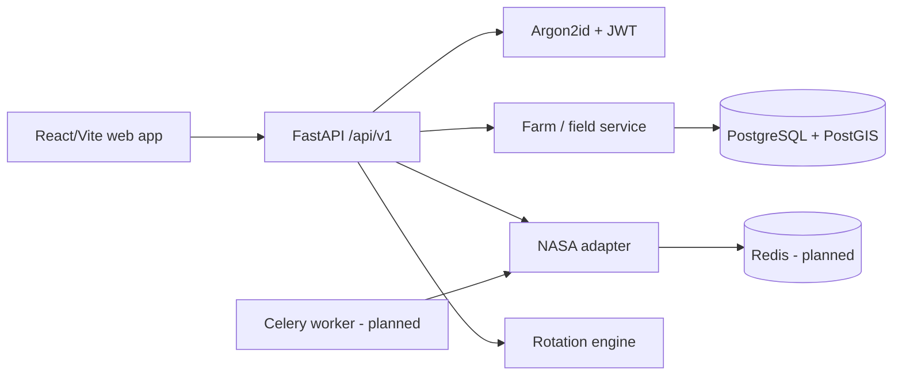

# AgriSpace architecture

Data mode is explicit. With `NASA_POWER_ENABLED=false`, the adapter returns an `AgriSpace simulated dataset` payload with `simulated: true`. It never labels simulated observations as NASA results.

## Boundary storage

The development profile accepts a closed GeoJSON `Polygon`, validates coordinate ranges, and calculates an approximate local geodesic area. The deployment profile is intended to migrate it to PostGIS `geometry(Polygon,4326)` with a GiST index and `ST_Area(geography(boundary))` as the authoritative area calculation.
